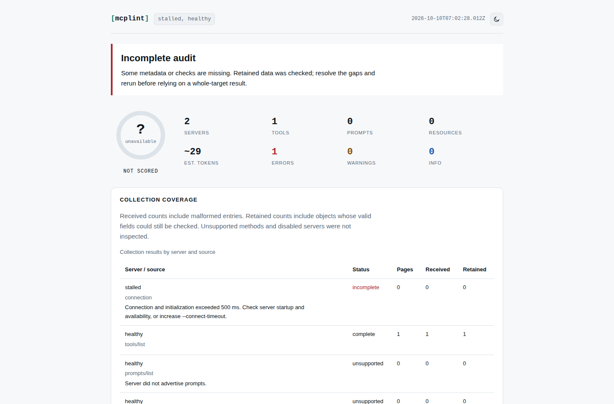

# Connection deadlines checked against real transports

A server could stop a whole config audit before any tool list was inspected.
The MCP SDK starts a legacy SSE connection **before** starting its initialization
request timer. A server that returns HTTP 200 and opens an event stream without
an `endpoint` event leaves that phase waiting. After initialization, the final
notification can also wait for an HTTP response outside the request timer.

This work is local and unreleased. Code commit `eb34619` adds one budget for
transport startup and the complete handshake: **30 seconds by default**, changed
with `--connect-timeout <milliseconds>` or the `connectTimeoutMs` library option.
A legacy HTTP fallback spends the remaining budget. Once initialization is done,
the timer is cleared and the existing list deadlines apply independently.

A config timeout remains a failed connection with incomplete coverage. Later
servers are still audited, the score remains unavailable, and `--fail-on error`
and `--fail-on warning` still fail. Single-target connection failures exit 2.

## Reproduction

The previous source, `01e94fc`, remained pending after **65 seconds**, with a live
response, in the [long observation](results/before-65-seconds.json). The watchdog
terminated the controlled client; this was not a natural timeout. It is an
observation over that interval, not a measured infinite runtime.

[`verify.mjs`](verify.mjs) starts actual loopback HTTP servers and separate Node
processes using the package's real SDK clients. A 500-ms connection deadline makes
failures practical to replay. The old API ignored that unknown option; the old
CLI is run without the option it did not implement. Every request method and RPC
name is retained. No remote servers or `tools/call` requests are used.

| Scenario | Previous source | Corrected behavior |
| --- | --- | --- |
| SSE with no endpoint or no response headers | Watchdog required | Deadline; active response closes |
| HTTP initialize never responds | Watchdog required | Deadline; no legacy retry |
| Initialization succeeds but notification stalls | Watchdog required | Deadline; no tool list attempted |
| POST 405, then SSE without endpoint | Watchdog required | Fallback uses remaining budget |
| HTTP 500 | Falls back to the fixture's silent SSE; watchdog required | Original failure; no legacy GET |
| Silent stdio process | Watchdog required | Deadline, then SDK terminates direct child |
| Stalled server followed by a healthy config server, API and CLI | Watchdog required; healthy server not reached | Healthy tool retained; score unavailable; exit 1 with gate |
| Valid legacy server | Completes | Completes |
| Valid tool list slower than connection budget | Completes | Completes under its own list deadline |

The [baseline](results/before.json) records nine disagreements with the corrected
behavior across eleven scenarios; [current source](results/after.json),
[installed tarball on Node 26.7.0](results/installed.json), and
[the same installed package on Node 20.0.0](results/installed-node20.json) record
none. The scenarios are constructed protocol failures and controls, not a
survey of real server reliability.

With the installed current-Node package, the silent HTTP/SSE processes exited in
782-859 ms including module loading and the 500-ms budget. The silent stdio case
exited in 2,782 ms because shutdown also allowed the child its SDK grace period.
These are single local observations, not performance guarantees. Each report
records the measured elapsed time, natural exit or watchdog intervention, active
responses after exit, and whether the directly spawned stdio child still existed.
The baseline watchdog explicitly kills its own fixture child when needed.

## Run it yourself

From the repository root:

```sh
npm ci
node studies/connection-deadlines/verify.mjs --out /tmp/mcplint-connections.json
npm run test:browser
```

To retain the actual incomplete HTML report as well:

```sh
node studies/connection-deadlines/verify.mjs \
  --out /tmp/mcplint-connections.json --html /tmp/mcplint-connections.html
```

For the old source, build a separate `git archive 01e94fc` checkout with `npm ci`,
then pass its compiled `dist/` to the same script:

```sh
node studies/connection-deadlines/verify.mjs \
  --dist /path/to/old-checkout/dist --observe-only --out /tmp/before.json
# The longer observation (watchdog stops only this controlled client):
node studies/connection-deadlines/verify.mjs \
  --dist /path/to/old-checkout/dist --case sse-no-endpoint \
  --watchdog 65000 --observe-only --out /tmp/before-65-seconds.json
```

`--dist /path/to/install/node_modules/@antonsoloviev/mcplint/dist` tests a packed
installation; `--node /path/to/node` selects the runtime for every child. The
runner itself can use the development runtime. Generated configs live in an
ignored, unique study-cache directory and are removed afterward.

## Verification of the local change

A fresh `git archive` checkout of code commit `eb34619` passed `npm ci`, lint,
type checking, all **355 tests**, and `npm run build:site` (output: `site/`).
The production-site browser suite passed **24 checks in Chromium and Firefox**.
The eleven transport workflows also passed against an `npm pack` tarball
installed outside the repository, on both Node 26.7.0 and the declared minimum
Node 20.0.0. Those installed-package results are linked above.

The package version remains 0.3.3; this is a local build of the corrected source,
not a new registry release. No branch, registry package, or hosted site was
published by this work.

## Actual report and boundaries

[Open the retained offline report](../../docs/assets/connection-deadline.html).
It names the stalled connection, the completed healthy list, and the missing
coverage instead of assigning a score to the one server that replied.



The screenshot was made by opening that generated file in Chromium, with no page
errors, and visually inspected. The existing report UI was not redesigned.

This budget does not time-bound parsing, schema compilation, linting, or the
whole multi-server audit. Event-loop scheduling and transport cleanup can extend
wall-clock duration past the deadline. The stdio check proves cleanup of the
directly spawned fixture, not arbitrary detached descendants of a wrapper such
as `npx`. Extremely slow legitimate startup may need a larger value, for example
`mcplint stdio --connect-timeout 120000 -- node server.js`.

Fallback only follows an HTTP 4xx rejection of initialization, as described in
the pinned [MCP transport specification](https://modelcontextprotocol.io/specification/2025-06-18/basic/transports#backwards-compatibility).
An HTTP 405 after successful initialization is a failed notification, not a
reason to restart the audit using a different transport. The regression suite
also checks this boundary and preserves authorization headers on valid legacy
connections.
