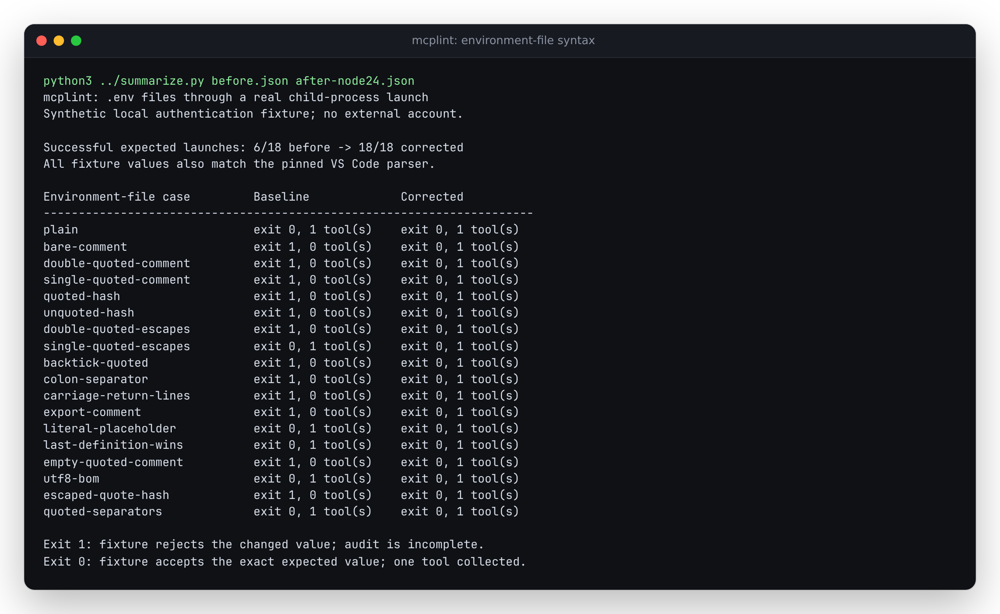

# A valid environment file must launch the same server configuration

This source correction fixes an actual `mcplint config` launch failure. With
baseline `a3012df766f87b5ee753fca93249cba0458bc47d`, the environment file

```dotenv
MCPLINT_ENVFILE_TOKEN="synthetic-token" # fixture account
```

passes the quotes and comment to the child as part of its token. A local fixture
that expects `synthetic-token` rejects initialization; `--fail-on error` exits 1
and the audit is incomplete. After the correction it accepts the value and
mcplint collects its one tool with exit 0. All credentials and servers in this
study are synthetic. No external account or service is accessed.

| Retained cases | Baseline | Corrected |
| --- | ---: | ---: |
| Parsed maps matching the pinned VS Code parser | 6/18 | 18/18 |
| Actual CLI launches with the expected child values | 6/18 | 18/18 |



## Reference and behavior

[`cases.json`](cases.json) defines the input bytes as UTF-8 strings and literal
expected values. [`oracle.mjs`](oracle.mjs) fetches and hash-checks the actual
[VS Code parser at commit 3b486b1](https://github.com/microsoft/vscode/blob/3b486b1ff92ac032974c6f589e7d5a46fe486067/src/vs/base/common/envfile.ts),
transpiles that standalone TypeScript function, and executes it against every
case. Every fixture expectation agrees with it. The reference source is
Microsoft's MIT-licensed code; it is fetched for the study, not bundled into
mcplint. The [before](results/oracle-before.json) and
[after](results/oracle-after.json) records include its URL, SHA-256 and byte size.

The correction parses comments only outside matching quotes. It preserves a
quoted `#`, accepts single/double/backtick quotes, decodes `\n` and `\r` only
inside double quotes, and recognizes `=` or `:` separators and CR/LF/CRLF line
endings. Empty values, duplicate-key replacement, a leading UTF-8 BOM and
literal `${...}` text are covered. Values are never shell-evaluated or expanded.
Explicit `env` entries, including null removals, still override `envFile`.

This is the reference's line-oriented grammar. Physically multiline quoted
values are not implemented; an escaped newline inside double quotes works.
Other dotenv libraries may differ. No claim of universal dotenv compatibility
or full equivalence with every client launcher is made. The pre-existing
`export`-followed-by-whitespace support remains.

## Actual process checks

[`replay.py`](replay.py) writes each file's exact bytes, starts the real CLI and
records the actual child values before the fixture's initialization decision.
It checks those values, exit status, audit completion and collected tool count.
Only two named synthetic variables are recorded; the ambient environment is
never dumped. The [baseline](results/before.json) and
[corrected Node 24 run](results/after-node24.json) retain every observation.

After `npm ci`, run from the repository root:

```sh
node studies/envfile-syntax/oracle.mjs dist/collectors/config.js /tmp/mcplint-envfile-oracle.json
python3 studies/envfile-syntax/replay.py --node "$(command -v node)" --cli dist/cli.js --out /tmp/mcplint-envfile-launches.json
```

Only the oracle command fetches a pinned public source file. The launch replay
uses local files and stdio. The ordinary regression suite uses the retained
literal expectations and does not fetch the reference.

## Clean and installed verification

A clean archive of production commit `e40da14e97471a0fa9ed8737c891ab93b3d49ff6`
passed `npm ci`, lint, typecheck, 483 tests in 40 files, CLI/site builds and
28 Chromium/Firefox report workflows, including offline desktop and 375 px
checks. The terminal capture was generated from `summarize.py` output and
opened for visual inspection. `npm run build:site` produces `site/`.

The packed artifact was installed offline outside the checkout. All 104
package files match the tarball; 100 source, test and selected configuration/
fixture inputs match the clean archive. The tarball is 106,103 bytes with
SHA-256 `75ff49b06a1f209130147e0948f30ba2e4811ad111090e620bac3994418878f0`.
The [artifact receipt](results/artifacts.json) records hashes and check outcomes.

All 18 actual installed launches pass on [Node 20.0.0](results/after-node20.json)
and Node 24.21.0, with identical case records. The clean archive uses the locked
MCP SDK 1.31.0 and the offline installation resolves compatible SDK 1.32.1.
The earlier 36 installed [environment-removal cases](../config-env-unset/README.md)
also remain correct; their complete replay record is byte-identical to the
retained control. Runtime checks were on Linux/WSL2; no Windows or macOS
execution is claimed.

Package version 0.3.3, release tags and hosted files remain unchanged. These
are source and local artifact checks, not a new registry release or deployment.
