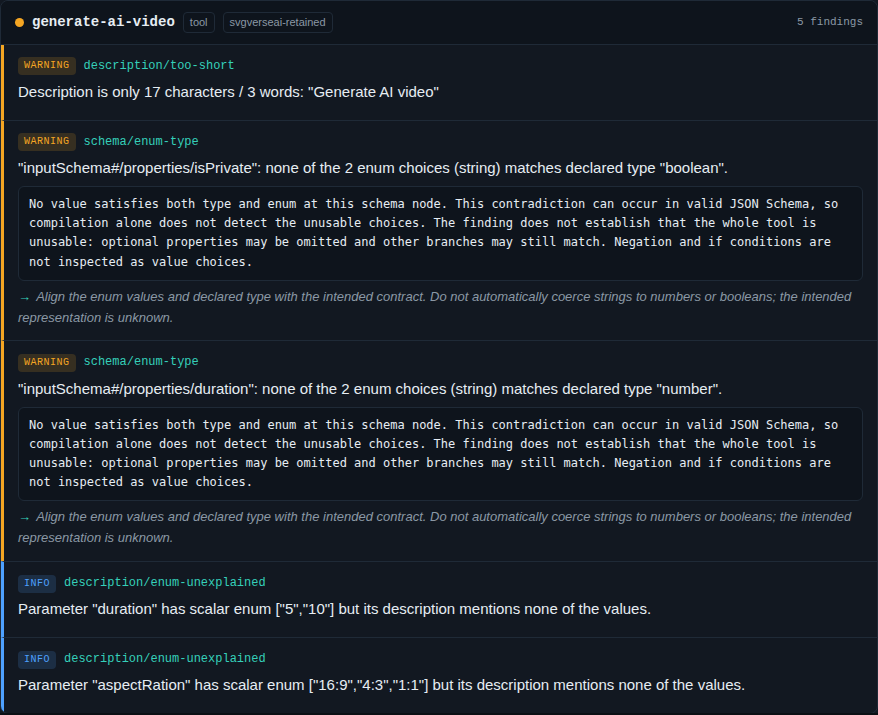

# Declared choices that cannot satisfy their type

Public registry metadata for `Svgverseai/svgverseai-mcp` contains four local
contradictions in three tools. The schemas compile successfully, but every
advertised value for these parameters fails JSON Schema validation:

| Tool | Parameter | Declared type | Enum values |
| --- | --- | --- | --- |
| `generate-ai-video` | `duration` | `number` | `"5"`, `"10"` |
| `generate-ai-video` | `isPrivate` | `boolean` | `"true"`, `"false"` |
| `generate-blaze-image` | `isPrivate` | `boolean` | `"true"`, `"false"` |
| `generate-spark-image` | `isPrivate` | `boolean` | `"true"`, `"false"` |

A string `"5"` fails the numeric type, and a number `5` fails the string enum.
Likewise neither `"false"` nor `false` can satisfy the boolean parameter.
These fields are optional: `{}` is accepted by every captured input schema.
This does **not** establish that the whole tool is uncallable, that generation
fails, or that private content becomes public. No generation tool was called.
The linter cannot choose the representation the implementation intends.

[Open the offline report](https://antonsoo.github.io/mcplint/enum-choices.html)
and inspect the [rule and its limits](../../docs/rules/schema-enum-type.md).
The public report contains all six original tool definitions; the focused CLI
replay contains the three tools in the table.



## Native source and current recheck

The original held-out census response was read on 2026-10-08. A fresh public GET
to [the same registry endpoint](https://registry.smithery.ai/servers/Svgverseai/svgverseai-mcp)
on 2026-10-20 returned exactly the same 7,311 bytes, SHA-256
`62ea1bc90413820ab2788a7209be953172ab77bf0bd98803318da270b8c8c1c1`.
Both responses are retained, compressed, in `captures/`; `provenance.json`
records the endpoint, time, selection and third-party notice. Registry metadata
is evidence of the published contract, not a capture of the vendor's runtime.

`captures/tools.json` and `captures/all-tools.json` retain complete, unchanged
definitions from that response. They are not synthetic replacements. The local
SDK replay implements only metadata discovery and refuses tool execution.

## Before and after

Baseline source: `c0be1c15c69ff093ef0d11858275cee449b9ca81`. Default audits of
the same three definitions have these results:

| Observation | Before | After |
| --- | ---: | ---: |
| Complete collection | yes | yes |
| Errors | 0 | 0 |
| Warnings | 2 | 6 |
| Information findings | 7 | 7 |
| `schema/enum-type` findings | 0 | 4 |
| Heuristic score | 94 | 89 |

`before.json` and `after.json` retain those reports. The score is a display
heuristic, not a measure of runtime correctness.

`gate.json` isolates the new rule by explicitly ignoring the same three
pre-existing budget/description rules on both sides. With those controls,
`--fail-on warning` changes from exit 0 to exit 1. The unfiltered baseline
already has two warnings; it would not pass that warning gate.

`sdk.json` repeats the isolated gate through the real MCP SDK stdio transport.
Both collectors request `tools/list` once and never request `tools/call`.
Metadata snapshots compare completely unchanged: three tool definitions and
one initialization record. The warning comes from linting the same evidence.

## Independent checks and regression boundary

`oracle.mjs` enumerates 780 finite domains: 12 representative JSON values,
their singleton and two-value enums, and 10 types/type unions. Ajv validates
every candidate without coercion. A separate Python `jsonschema` validator
checks the same candidates and the four native contradictions. Both agree with
the rule, including boolean versus number, integer versus number, null,
structured values, type unions and mixed enums with a usable member.

The full retained census replay covers **1,304 servers and 25,799 tools**,
with zero skipped records. Every old finding, collection-completeness result
and token estimate remains unchanged. Exactly four warnings are added, all
at the locations above. `corpus-results.json.gz` retains each source hash,
existing-finding hash, added finding and compiled-module identity. This corpus
is a regression boundary, not proof about all MCP servers or all JSON Schema.

The check uses the enum as the complete local candidate set. It does not
resolve references, execute patterns, infer conditional satisfiability or
rewrite values. It skips negation/`if` tests and respects supported dialect
positions and legacy `$ref` siblings. A local empty intersection can live in
an optional property, unused definition or unreachable union branch. That is
why the finding is a warning with an exact local pointer.

## Reproduce from source

Use Node 24 and the locked dependencies. From this checkout:

```sh
npm ci
node dist/cli.js file studies/finite-choices/captures/tools.json --format json
node studies/finite-choices/oracle.mjs /tmp/enum-oracle.json
python3 studies/finite-choices/oracle.py /tmp/enum-oracle.json /tmp/enum-python.json
```

The separate Python check needs `jsonschema` (the retained run used 4.10.3).
The controls in `captures/controls.json.gz` can be checked directly too.
To compare the old and new SDK collectors, first build the baseline commit in
a separate checkout with its locked dependencies, then run:

```sh
node studies/finite-choices/verify-cli.mjs /path/to/baseline/dist/cli.js dist/cli.js /tmp/enum-sdk.json
node studies/finite-choices/corpus.mjs /path/to/baseline/dist/index.js dist/index.js /tmp/enum-corpus.json.gz
npm run build:site
node studies/finite-choices/browser.mjs
```

The corpus command requires the retained `studies/registry-census/cache/`
responses; those downloads are not in the package. The browser command uses
installed Playwright browsers. Its four cases exercise Chromium and Firefox
at 1,440 and 375 pixels, offline report behavior, keyboard theme switching,
overflow, CSP errors and axe accessibility checks. `browser.json` records the
local run, with real screenshots in `docs/assets/finite-choices/`.

## Delivery boundary

[Clean-source and package verification](installation.json) records a fresh
locked install under Node 24.22.0: lint, types, all 659 tests in both default
and comma-decimal locales, all 32 existing browser cases, the four native
report cases and a packed-package consumer install. All 130 installed package
files equal the tarball payloads. The installed SDK replay reproduces the
gate change on [Node 24](installed-sdk.json) and the supported [Node 20.0.0
floor](node20-sdk.json), with no tool calls.

This is a source improvement and a locally built package, not an npm release.
[Publication verification](publication.json) checks all 36 changed files at
public source revision `a2fe7ff3bac82f417d3c404a25f363ad9d23f3fc` and all
12 hosted files against the reviewed build. The deployment preserves every
previous site file. [Hosted browser replay](hosted-browser.json) verifies the
four report cases, including offline keyboard use after initial loading.
Firefox's implicit origin-favicon probe is blocked by the existing policy and
recorded separately; no other policy violations were accepted. No vendor
deployment or implementation has been changed.
