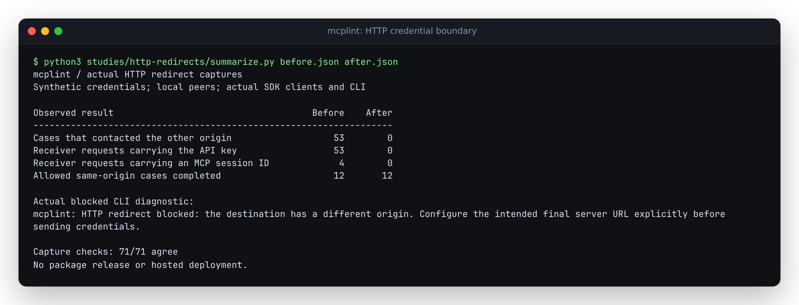

# HTTP redirects must not forward MCP credentials to another origin

A server redirect could send configured API keys to a different origin before
mcplint reported a connection error. Native fetch removed `Authorization`, but
forwarded `X-API-Key`. After initialization it also forwarded the session ID
issued by the MCP server. The same problem affected legacy SSE connections and
their separate message POSTs.

The retained reproduction uses synthetic credentials and local HTTP peers on
different loopback ports. It runs actual MCP SDK clients and the built CLI.
The baseline is source commit `160cd9bae63649970c308af9f2d3b0c40d27b0f2`.

| Observed behavior across 71 cases | Before | After |
| --- | ---: | ---: |
| Cases that sent a request to the other origin | 53 | 0 |
| Requests received there with the API key | 53 | 0 |
| Requests received there with a server-issued MCP session ID | 4 | 0 |
| Allowed same-origin collection cases completed | 12/12 | 12/12 |

Full observations: [baseline](results/before.json),
[corrected clean Node 24](results/after-node24.json), and
[installed Node 20](results/installed-node20.json).



The correction manually checks each redirect before issuing the next request.
The destination must retain the configured scheme, host and port. Same-origin
redirects remain supported, with a 20-hop limit per request. This applies to
both transports, fallback, initialization and later list requests. A moved
service needs its intended final URL configured explicitly.

## Reproduce and inspect

After `npm ci`, from the repository root:

```sh
node studies/http-redirects/capture.mjs . --check > /tmp/mcplint-http-redirects.json
```

Pass another built package directory instead of `.` to exercise that artifact.
The capture does not require checkout fixtures inside that package. It records
both peers' received methods, paths, bodies and selected synthetic headers,
plus CLI exits and collection state. It covers 301/302/303/307/308 redirects,
direct Streamable HTTP, explicit SSE, automatic fallback, redirected SSE
message posts, post-initialization requests, same-origin-then-foreign chains,
loops, and a mixed config that retains a healthy server's tool.

The 71 cases are 35 library workflows, the same 35 through the CLI, and one
mixed-config CLI workflow. A blocked list remains incomplete. A blocked
initialization produces a connection failure; config collection records it and
continues. Diagnostics omit the destination URL and its synthetic query token.

The regression tests separately compare same-origin method/body/header behavior
with native fetch for five redirect statuses and GET, HEAD, POST and DELETE.
They verify the 20-hop boundary, loop rejection, cancellation, a missing Location,
and changed scheme/host/port, malformed URLs and embedded credentials.

## References and scope

The [Fetch redirect algorithm](https://fetch.spec.whatwg.org/#http-redirect-fetch)
defines method rewriting and the redirect limit. The implementation preserves
POST bodies on 307/308 and drops bodies and body headers when a redirect changes
the method to GET. The stricter origin boundary is mcplint's credential policy.
The [MCP transport specification](https://modelcontextprotocol.io/specification/2025-06-18/basic/transports)
describes session headers and legacy fallback.

These are controlled local HTTP captures, not observations of a malicious public
service. Origin matching is not DNS pinning or a network destination allowlist.
The internal fetch wrapper handles the SDK's JSON-string requests and bodyless
requests; it refuses non-string bodies rather than retrying consumed streams.
Runtime receipts describe the Node versions actually exercised. This work changes
source and local artifacts; it does not release the package or deploy the site.

## Clean and installed verification

A clean archive of production commit
`c357b749d4a78a0341b6bbd619936c8130f12842` passed locked installation, lint,
typecheck, all 492 tests in 42 files, the production build, the site build and
the documented good stdio fixture. The installed command also read a saved
tool list. The terminal image above was rendered from `summarize.py` output and
opened for inspection. No web UI code changed; no new browser validation is claimed.

The [artifact receipt](results/artifacts.json) compares 139 source/test/build
inputs and all 152 built files (400,247 bytes) with the clean archive. All 106
package files match the archive, tarball and separate offline installation.
The tarball is 108,160 bytes, SHA-256
`b87b8fe75cda9045e5caffc8c30193fc98994e51b8132d27794a9c1b37b87a46`.

The clean archive uses MCP SDK 1.31.0; the offline installation resolves
compatible SDK 1.32.1. All 71 workflows pass from that installed package on
Node 24.21.0 and the declared minimum Node 20.0.0. The installed Node 24 capture
is byte-identical to the retained clean capture; both hashes are in the receipt.
Node 20 interleaves optional GET and list requests differently in four allowed
cases, but the request contents and all outcomes match. Execution was on
Linux/WSL2. Package version 0.3.3 and hosted files remain unchanged.
