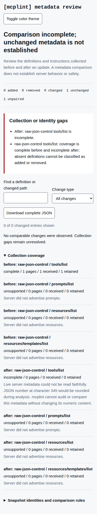

# Live responses must not become falsely unchanged metadata

Two synthetic local MCP servers return the same tool with different integer
constraints: `minimum: 9007199254740992` and `minimum: 9007199254740993`.
At baseline `842910b8f4e387613040943cc7ad11f8e16d2892`, native JSON decoding in
the SDK rounds the second number. Both snapshots become identical and the real
CLI reports an unchanged comparison with exit 0. Saved-file checks cannot repair
evidence already lost in live decoding.

The collectors now validate original response text before passing its bytes to
the SDK. This uses the same decimal-serialization and duplicate-field policy as
the [saved JSON repair](../json-integrity/README.md), including its limits.

| Input / workflow | Baseline | Repaired source |
| --- | --- | --- |
| Representable integer on all four transports | Complete capture | Byte-identical complete capture |
| Neighboring integer that would round | Complete, falsely equal capture | Incomplete, damaged page excluded |
| Escaped duplicate field on page two | Last value silently wins | First page retained; collection incomplete |
| Actual CLI audit of rounded input, `--fail-on error` | Exit 0 | Exit 1, incomplete report, score `null` |
| CLI JSON or offline HTML diff against valid input | Exit 0, unchanged | Exit 2, incomplete; no invented removals |

The four transports are stdio, Streamable HTTP with a JSON response, Streamable
HTTP with SSE responses, and legacy HTTP+SSE. These are local controlled servers,
not observations of third-party server behavior. The HTTP controls include
multi-line SSE data, event IDs, comments, retry fields and a legacy endpoint event.
They only answer initialization and metadata-list requests.

`replay.mjs` launches real servers and the built CLI, saving each raw response,
snapshot, comparison, stdout, stderr and exit code. It fixes the API capture time
so valid snapshot bytes can be compared exactly. CLI timestamps remain real.

```sh
npm ci
node studies/live-json/replay.mjs dist/cli.js /tmp/mcplint-live-json-replay after
node studies/live-json/browser.mjs /tmp/mcplint-live-json-replay /tmp/mcplint-live-json-browser
```

Both replay directories must be chosen for the local run; the first must not
already exist. To reproduce the baseline, build the commit named above and pass
its `dist/cli.js` with expectation `before`. The script and fixture come from
this study's checkout; metadata is collected through the supplied build. The
same script accepts a fresh installed package's `dist/cli.js` to check shipped
code separately from the source checkout.

The transport regressions additionally exercise numeric overflow, underflow,
precise decimals, ambiguous initialization, fragmented UTF-8, invalid UTF-8,
malformed JSON, truncated stdio messages, the stdio byte ceiling and permissive
HTTP content types accepted by the SDK. A final valid stdio page followed by a
damaged notification in the same write retains that page but marks the connection
incomplete. Child-process checks cover cooperative shutdown and a server that
ignores both EOF and SIGTERM; collection returns after the direct child closes.
Diagnostics do not echo server-controlled field names, literals or response text.

## Retained verification

[Before](results/before.json) and [after](results/after.json) retain the full
API and CLI observations. The [artifact receipt](results/verification.json)
records a byte-matched 433-file archive of implementation `58fa1ed`, locked
installation, lint, type checking, 603 passing tests, build and pack. All 86
rebuilt baseline runtime files also match the earlier committed artifact receipt.

Fresh [Node 20.0.0](results/installed-node20.json) and
[Node 24.21.0](results/installed-node24.json) installs each match all 121 shipped
files and pass the complete replay. Their SDK resolves to 1.32.1, while the
locked source uses 1.31.0; all API captures and comparisons remain identical.
Valid CLI snapshots differ from baseline only in `createdAt`, and valid audit
JSON differs only in `generatedAt`. The tarball is 132,445 bytes, SHA-256
`33d7eadfbe73ca98e5d90b15dd8b672347c1b8480785153a165d820aa6bf9e4c`.

The exact [installed CLI HTML report](results/diff.html) was opened offline in
Chromium 153.0.8010.12 and Firefox 155.0 at 1440 px and 375 px. Each workflow
expands the coverage reason and downloads JSON identical to the CLI comparison.
There were no page errors, external requests, horizontal overflow or axe
violations in these four views. [Browser observations](results/browser.json)
retain the report hash and visible text. All four screenshots were inspected;
the status and numeric-integrity reason remain readable at both sizes.



The receipt also records corrected harness assumptions and npm's blocked
dependency install script. Those did not require changes to report rendering
or a package release. Timings describe these runs, not a latency guarantee.

## Boundaries

- A failed live list can still produce a useful partial report or snapshot.
  Earlier pages remain evidence; they are never presented as a complete inventory.
  A bad initialization response instead fails the connection.
- This checks decimal serialization, not exact binary arithmetic. Numeric schema
  constraints must remain numeric; changing them into strings is not a general
  workaround. Ordinary decimals and equivalent exponent spellings remain valid.
- Whole messages are checked, including envelopes and notifications received
  while collecting. A snapshot retains only initialization fields exposed by the
  SDK and decoded list entries; it is not a raw transport archive.
- Messages in a damaged HTTP stream chunk can be discarded together. Previously
  collected pages remain retained; no claim is made that every otherwise valid
  message in that damaged chunk survives.
- Stdio messages have the existing 10 MiB ceiling. Metadata JSON has a 128-level
  container limit. HTTP buffering, parsing and SDK validation are not an overall
  memory/CPU sandbox. Existing page, item and time limits remain in force.
- Already-decoded JavaScript objects and older snapshots cannot recover lost
  fields or digits. Detached child processes are outside direct-child cleanup.
- This is an unreleased source change. No npm release or hosted-demo deployment
  is implied by the source, package-install or browser evidence.
