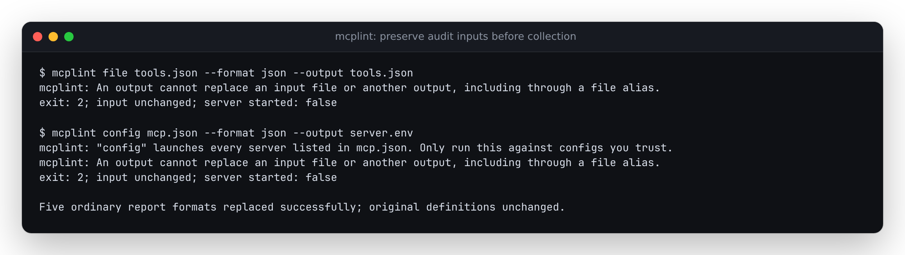

# Preserve audit inputs when saving a report

Source correction, verified 2026-10-12. No npm release or hosted deployment.

At baseline `1c523ab1e6dbf72cfd565fcb02b7752ce04018ad`, snapshot comparisons
protected their inputs, but ordinary audits did not. An audit could finish
successfully and replace the definitions or settings it had just read.

The [before replay](before.json) uses disposable copies of the existing
20,406-byte [filesystem definitions fixture](../../tests/fixtures/reference-servers/server-filesystem.json),
originally captured by [the reference-fixture script](../../scripts/dump-reference-fixtures.mjs).
Configuration cases launch the existing local SDK test server with controlled
environment values. A wrapper writes a startup marker before importing that
server. No real client configuration, credentials or remote servers are used.

| Input selected as output | Before | After |
| --- | --- | --- |
| Tool definitions | Exit 0; definitions replaced by report | Exit 2; original bytes retained |
| Explicit or automatically selected lint config | Exit 0; config replaced | Exit 2 before audit |
| MCP client config | Server starts; config replaced | Exit 2; server remains unstarted |
| Configured environment file | Server starts; env file replaced | Exit 2; server remains unstarted |

Each of these five input types is checked via a direct path, symlink, hard
link and symlinked parent: twenty actual CLI calls per replay. All twenty
overwrote the input before; the [after receipt](after.json) preserves every
input and records no configured server startup. The definitions alone went
from 20,406 bytes to a 5,496-byte JSON report. Tests also protect missing env
files, resolve supplied `${input:...}` paths before any server starts, and
keep the existing incomplete-audit result when a missing env file is unrelated
to the outputs.



The audit and diff paths now share output validation. The lint-config loader
and CLI share config discovery, and config collection exposes its resolved
source paths before starting servers. Existing file identities and resolved
ancestor paths catch aliases, including new output names through symlinked
parents. Report/snapshot destinations must also differ from one another.
Output symlinks and non-regular report destinations are refused.

Reports are written to private temporary siblings, flushed, and renamed over
the destination. Snapshots retain exclusive new-file creation; a failed new
write removes that incomplete file. A separate [POSIX experiment](write-failure.py)
sets only the child process's per-file size limit to 4,096 bytes. The operating
system returns `EFBIG` while writing either a report or a new snapshot.
[Before](write-before.json), this leaves a truncated old report or incomplete
new snapshot. [After](write-after.json), the old report and input remain intact,
the failed new snapshot is absent, and no temporary files remain. This does not
fill a disk or alter the invoking shell's limits.

All five ordinary formats still replace reports successfully: terminal, JSON,
SARIF, Markdown and HTML. Their contents match the baseline after removing only
the single generation timestamp where present; SARIF is byte-identical. The
receipts retain raw and normalized hashes. Lint rules, findings, coverage and
report rendering are unchanged.

## Replay

After `npm ci`, choose a directory that does not already exist:

```sh
node studies/report-inputs/replay.mjs /tmp/mcplint-report-check dist/cli.js
python3 studies/report-inputs/write-failure.py /tmp/mcplint-write-failure dist/cli.js
```

The second command requires POSIX `resource`/`SIGXFSZ` support. Both scripts keep
their disposable inputs, outputs and receipts. Each accepts an installed CLI
path; the Node replay uses its current Node executable, and the Python replay
accepts `--node`. To check the old behavior, build the baseline separately and
use a different new directory plus `before` (Node) or `--expect before` (Python).

Only the report replacement is atomic. Snapshot creation and report replacement
are separate operations: a successful snapshot remains if the later report
write fails. New/replaced files use private permissions (0600 on POSIX).
The guard covers inputs read by mcplint, including resolved env-file paths,
not arbitrary files opened by a launched server. It is not a filesystem lock,
cannot protect shell redirection, and does not guarantee whole-machine
power-loss recovery. No tool calls are executed by these checks.
