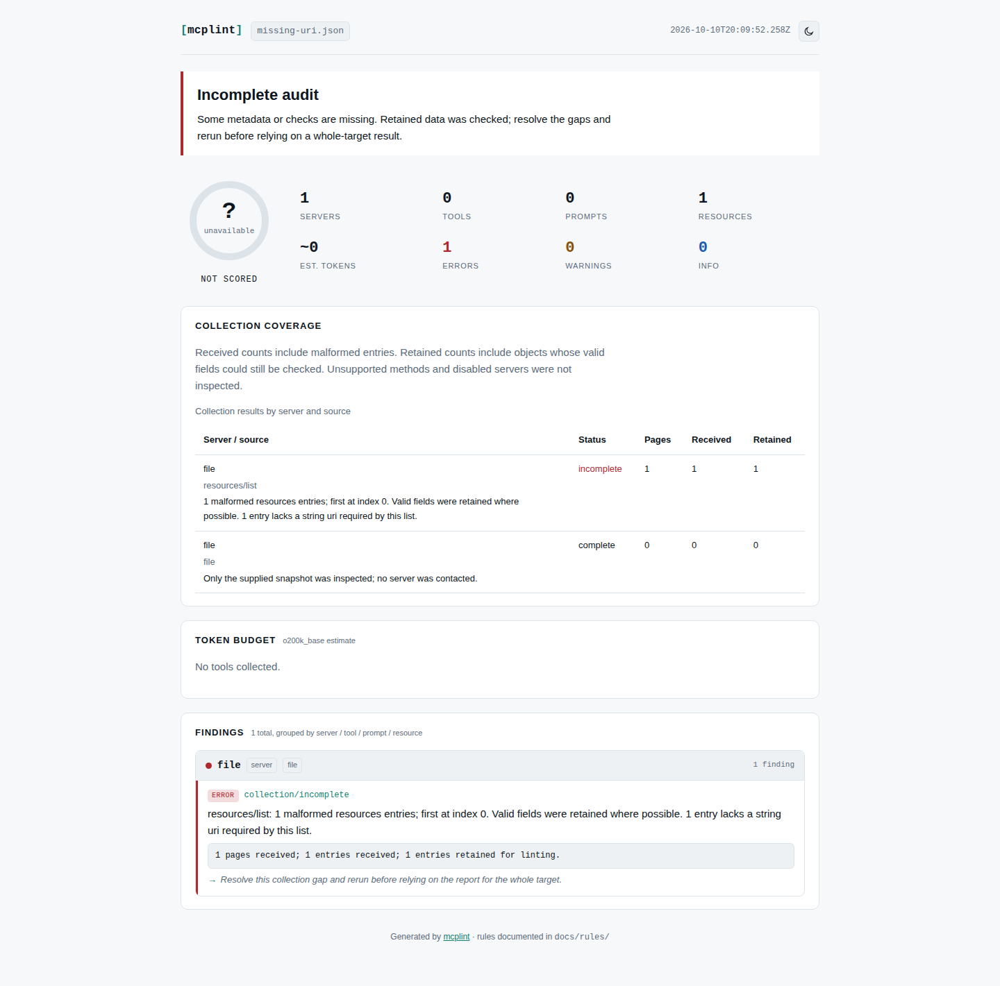

# A resource without an identity cannot receive a complete audit

At source `38f9366`, a `resources/list` object without `uri`, or a
`resources/templates/list` object without `uriTemplate`, produced a **complete
audit, score 100, and successful error gate**. The collector checked the type
only when a field was present. A URI template also incorrectly sufficed for a
concrete resource, and vice versa.

The [MCP resource specification](https://modelcontextprotocol.io/specification/2025-11-25/server/resources)
defines these different identities. The SDK's `ResourceSchema` and
`ResourceTemplateSchema` reject all four counterexamples. The correction uses
the list type to require its corresponding string field. It retains usable
metadata, marks that collection incomplete, withholds the score, and reports
the missing field. A malformed item's safety findings remain visible.

## Actual connections and reports

The [eight fixtures](cases.json) are constructed metadata, not observations of
malformed public servers. [server.mjs](server.mjs) serves them through the real
MCP SDK stdio transport. [replay.mjs](replay.mjs) invokes the actual CLI twice per
fixture: once on a saved snapshot and once against a new server process.

| Fixture | SDK shape check | Baseline complete / score | Corrected complete / score |
| --- | --- | --- | --- |
| Missing URI or template; wrong identity field (four cases) | Invalid | yes / 100 | no / unavailable |
| Wrong URI type | Invalid | no / unavailable | no / unavailable |
| Valid concrete resource or template (two controls) | Valid | yes / 100 | yes / 100 |
| One valid item plus missing-URI item with a hidden character | Invalid | yes / 90 | no / unavailable; safety finding retained |

Both transports agree. With `--fail-on error`, incomplete cases exit 1. Suppressing
the collection diagnostic does not restore completeness or a score. The fixtures
are never read as resource bodies, and no external service or tool is invoked.

- [Baseline](before-38f9366.json) and [corrected source](after.json).
- Actual CLI-generated [before HTML](browser-before/report.html) and
  [after HTML](browser-after/report.html), with JSON and SARIF alongside.
- [Before browser receipt](browser-before/receipt.json) and
  [after browser receipt](browser-after/receipt.json): Chromium and Firefox at
  1440 and 375 pixels, offline, zero HTTP requests, page errors or overflow.
- [Registry compatibility replay](corpus.json): 1,603 retained resources across
  272 snapshots, no missing identities and no changed collections. There were
  no templates in that corpus. Every cached file was checked against the
  [retained input hashes](../required-properties/corpus.json). This does not
  estimate how often malformed identities occur in live servers.

```sh
npm ci
node studies/resource-identity/replay.mjs
node studies/resource-identity/observe-browser.mjs
node studies/resource-identity/corpus.mjs /path/to/compiled-baseline
```

The first two scripts accept an installed package directory as their first
argument and a result file/directory as the second. Add `observe` as a third
argument to record old behavior without requiring the fix.



This check concerns required field presence and type. It does not validate URI
syntax or template expansion, contact resource locations, test access permissions,
or claim complete protocol conformance. Valid retained metadata still receives
only a heuristic audit, not a safety certification. Source fixes and locally
built tarballs are distinct from an npm release.

## Installed package verification

A clean clone of source `e2aa7b4` installed the lockfile, built a tarball, and
passed lint, typecheck and 380 checks. The working production HTML reports also
passed all 24 existing browser scenarios. A separate prefix installed only the
locally built package and runtime dependencies. Both this study's replay and
its counterpart pass on Node 26.7.0 and the declared minimum Node 20.0.0:
[installed](installed.json), [minimum Node](installed-node20.json).
The observed results equal the corrected source receipts (apart from the Node
version field on the minimum runtime).

Every compiled JavaScript file matches between working build, clean clone,
and installation. The [artifact receipt](../resource-identity/installed-verification.json)
records their hashes and the tarball SHA-256. Four additional offline workflows
opened HTML produced by the installed CLI in Chromium and Firefox at 1440/375 px;
JSON and SARIF agreed about incomplete coverage and withheld scoring.
[Installed browser receipt](../resource-identity/installed-browser.json).
