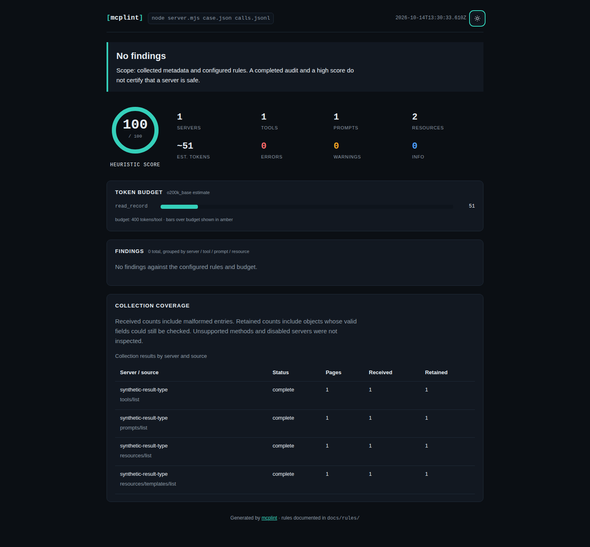
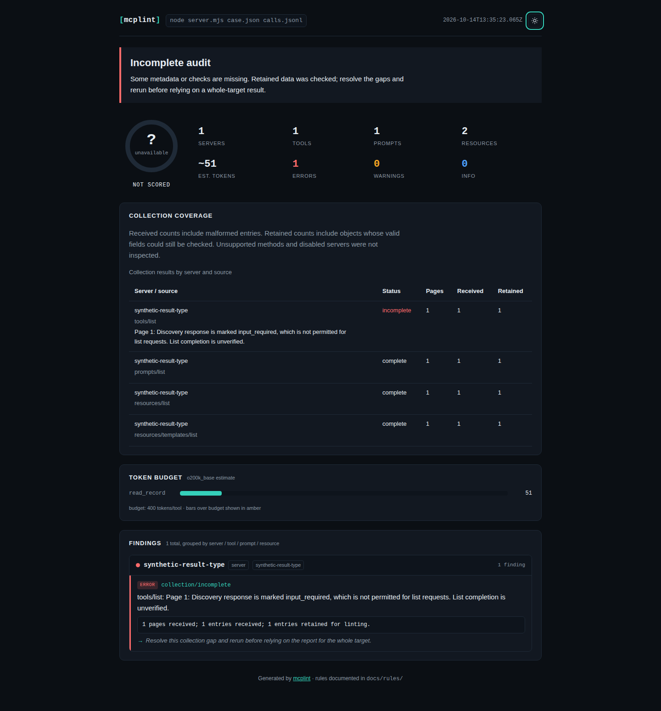

# Explicit non-complete discovery responses cannot establish coverage

At baseline `f808ea0`, an SDK-backed server returns a tool array alongside
`resultType: "input_required"`. The actual CLI reports **complete**, **score 100**
and **exit 0** with `--fail-on error`. Saved responses have the same failure:
usable definitions are mistaken for proof that discovery finished.

The [MCP multi round-trip specification](https://modelcontextprotocol.io/specification/2026-07-28/basic/patterns/mrtr#supported-requests)
permits input-required results only for `tools/call`, `prompts/get` and
`resources/read`, and forbids them on other requests. Discovery therefore
cannot treat such a result as a completed list. The general
[result discriminator](https://github.com/modelcontextprotocol/modelcontextprotocol/blob/main/schema/2026-07-28/schema.ts)
also distinguishes completion from unresolved input.

| Observation | Baseline | Corrected |
|---|---|---|
| Native SDK tool discovery with input-required marker | Complete, score 100, exit 0 | Incomplete, score unavailable, exit 1 |
| Usable definitions beside a non-complete marker | Retained | Retained and still linted |
| Non-complete second page with another cursor | Follows it and reports complete | Retains first/second-page definitions; stops that pagination stream |
| Suppressed collection diagnostic | Can remain falsely complete | Score unavailable and failure gate preserved |
| Missing definition in a non-complete saved response | Reports removal | Comparison incomplete; no removal claim |
| Legacy absent marker or explicit `complete` | Normal collection | Unchanged |

## Boundary and scope

Live discovery and saved-response collection share a discriminator check.
Missing markers preserve the existing legacy contract; explicit `complete`
markers are accepted. `input_required`, unknown strings and malformed values
mark collection incomplete, even when an item array is present. Received
definitions remain available for linting and snapshots. Nested literal data
with the same field name is not interpreted as an envelope discriminator.

The collector does not execute input requests, retry them with user input or
copy opaque `requestState`/`inputRequests` into audit diagnostics or snapshots.
Unknown discriminator values are not echoed in messages. This is a discovery
boundary correction, not full support for the newer transport or multi
round-trip protocol. The clean-source replay uses SDK 1.31.0; fresh tarball
installs resolve 1.32.1. Both use their negotiated 2025-11-25 contract to
transport deliberately contradictory response fixtures.
These are synthetic defects, not observations about a production server.

## Reproduction

```sh
npm ci --ignore-scripts && npm run build
node studies/result-types/replay.mjs --engine-root . \
  --out /tmp/result-types.json --label source
```

[`server.mjs`](server.mjs) uses the official SDK server and stdio transport.
The SDK is resolved from the tested source/installation's dependency graph.
Its request transcript verifies that collection only sends initialization
and discovery requests. No tool invocation or elicitation is performed.
[`cases.mjs`](cases.mjs) supplies constructed responses for all four list
scopes, malformed/unknown markers, explicit/legacy controls, nested literals,
late-page failure, suppressed diagnostics and retained hidden text.

[`replay.mjs`](replay.mjs) runs the actual CLI, captures its JSON/stdout/stderr
and snapshots, then checks saved-file collection and both library/CLI metadata
comparisons. The baseline [capture](results/before.json) disagrees in 27 of
34 workflows; [corrected](results/after.json) disagrees in none. The saved
late-page fixture was already incomplete because its cursor remained, so
that gate is a preserved control rather than another corrected failure.

The original single-tool native reproduction produces the 100-point false
complete result. The larger matrix includes prompts, resources and templates;
its scores are not a server-security or ecosystem-accuracy benchmark.
The captures distinguish partial coverage from empty inventories and retain
module hashes, SDK versions, request transcripts and definition digests.

To reproduce the baseline, build `git archive f808ea0` and pass that directory
as `--engine-root`, adding `--observe-only`. Consumer files stay in a fresh
temporary directory, with the case and server sources retained for inspection.

## Installed artifact and report verification

At implementation commit `bad0e5f`, a fresh Node 24.21.0 archive/install passes
lint, typecheck, **623 tests**, the same **623 tests in a German locale**, and
**32 existing Chromium/Firefox workflows**. The well-behaved SDK fixture passes
the warning gate; the poisoned fixture exits 1 at the error gate.

| Tested consumer | SDK | Native CLI, saved-file and comparison workflows | Disagreements |
|---|---|---:|---:|
| Baseline source, Node 26.7.0 | 1.31.0 | 34 | 27 |
| Clean corrected source, Node 24.21.0 | 1.31.0 | 34 | 0 |
| Fresh tarball install, Node 20.0.0 | 1.32.1 | 34 | 0 |
| Fresh tarball install, Node 26.7.0 | 1.32.1 | 34 | 0 |

The [verification receipt](results/verification.json) records all 448 archived
files matching the implementation commit, all 184 build files matching between
Node 24 and 26, and all 123 package files matching each fresh installation.
Installed audit reports and comparisons match the clean source, excluding only
the audit timestamp. Six valid-control reports match the baseline; all fifteen
non-paginated native definition inventories retain the same canonical digest.
The late-page fixture intentionally retains two pages rather than the baseline's
unverified third page.

The local tarball is **133,503 bytes**, SHA-256
`5db67efcab082c2fb6d6d567bf62dec421858c0bb220880af46ef7592c9b9124`.
The exact Node 20.0.0 installed bin also runs the version, saved-file terminal
and SARIF commands. npm 12 on Node 26 performed installation; the consumers
then ran under their stated Node versions.

[`browser.mjs`](browser.mjs) captures actual CLI JSON/HTML stdout from the SDK
fixture for ordinary and suppressed collection diagnostics. The baseline and
corrected source pass [16 offline workflows](results/browser.json); the fresh
installed artifact passes [8 more](results/installed-browser.json), across
Chromium/Firefox at 1440 and 375 px. All six HTML files byte-match a local HTTP
response before the exact files are opened offline. Each view checks the verdict,
score availability, keyboard theme control, accessibility, page overflow, script
errors, CSP violations and external requests. Twelve screenshots were inspected.





These are screenshots of the unedited standalone HTML stdout. The actual target
command, visible in each report, is `node server.mjs case.json calls.jsonl`.
The complete CLI argument list is in `browser.mjs`; the fixture is synthetic.

```sh
node studies/result-types/browser.mjs /tmp/baseline-source \
  /tmp/corrected-source /tmp/result-types-browser
```

The package retains version 0.3.3. This is an unreleased source snapshot and a
locally packed artifact, not the npm artifact already published at that version.
No npm release, tag or hosted deployment is part of this correction. Evidence-only
files added after the implementation commit do not change the archived product.
