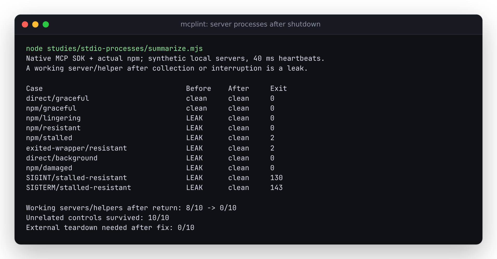

# Stdio shutdown must stop the server behind the launcher

Captured on 2026-10-15 with Node 26.7.0, npm 12.0.1 and MCP SDK 1.31.0 on
14-vCPU x64 WSL2 Linux (kernel 6.18.54.1, approximately 47 GiB RAM).

The pre-fix source (`117350c105c2f432c7421c963073a36c02b4ecac`) signalled only
the process it directly spawned. A real `npm run` launcher creates a shell and
server below that process. After collecting a valid tool inventory, mcplint
could print a complete report while the server continued its heartbeat and the
CLI stayed alive. With failed initialization, the CLI could exit with code 2
while its surviving descendants kept captured stderr open. A helper with no
inherited pipes also survived an otherwise successful, fully exited audit.

This study uses **synthetic local servers**, not a finding against an external
MCP service. The server registers a tool with the installed MCP SDK and uses its
native stdio transport. npm is the actual installed npm executable. A 40 ms file
heartbeat independently records whether the server/helper keeps doing work
after cleanup. Each case starts an unrelated control process and checks that it
survives. Fixture PIDs are used only by the replay's final cleanup, after the
observations have been recorded.

## Observed behavior



| Launch and condition | Before | After |
| --- | --- | --- |
| Direct server, exits on EOF | exits 0; server gone | exits 0; server gone |
| npm server, exits on EOF | exits 0; server gone | exits 0; server gone |
| npm server, timer survives EOF | report printed; CLI forcibly stopped; server alive | exits 0; one tool retained; server stopped |
| npm server, also ignores SIGTERM | report printed; CLI forcibly stopped; server alive | exits 0; one tool retained; server stopped |
| npm server, never initializes | CLI exits 2; captured stderr stays open; server alive | exits 2; server stopped; timeout retained |
| Launcher already exited, server ignores SIGTERM | CLI exits 2; captured stderr stays open; server alive | exits 2; server stopped |
| Server exits, background helper has no inherited pipes | exits 0; helper alive | exits 0; helper stopped |
| npm server sends duplicate JSON fields in tools/list | incomplete report printed; CLI forcibly stopped; server alive | exits 0; incomplete report retained; server stopped |
| SIGINT addressed to CLI during initialization | CLI exits on signal; server alive | exits 130; server stopped |
| SIGTERM addressed to CLI during initialization | CLI exits on signal; server alive | exits 143; server stopped |

The damaged-metadata case deliberately omits `--fail-on`: its incomplete report
keeps the established exit policy. Shutdown must not turn that inventory into a
complete audit. In interruption cases, no report is emitted.

The two graceful controls receive EOF and exit without SIGTERM. The other eight
cases previously retained a working server or helper; after the correction,
none retain an advancing heartbeat. The unrelated process survives every case.
`replay.mjs --expect-clean` asserts these outcomes, rather than merely recording
exit codes.

Raw receipts distinguish the CLI's `exit` event (`cliExit`) from closure of its
captured streams (`code`/`signal`). An orphan can keep stderr open after the CLI
itself has exited. The replay records that failure after its external deadline;
that forced teardown is never counted as product cleanup. Linux `/proc` also
distinguishes a running process from an unreaped zombie, which cannot advance
the heartbeat.

- [Baseline CLI receipt](results/before.json)
- [Corrected CLI receipt](results/after.json)
- [Terminal process-group SIGINT and interrupted two-server config](results/interruption-controls.json)

The extra interruption controls send SIGINT to the CLI's whole process group
(as a terminal does), and interrupt a two-server config. Both exit 130, stop the
active server and preserve the unrelated control. The config never starts its
second server. Its receipt replaces only the temporary directory in stderr
with `<scratch>`.

## Implementation and scope

POSIX launches use `detached: true` to establish an owned process group, while
remaining referenced and connected to their stdio pipes. Shutdown closes stdin
and gives EOF two seconds, sends SIGTERM to that group, gives it another two
seconds, then sends SIGKILL if it still exists. A launcher's exit is insufficient
evidence that its group is gone. The final wait for the direct child/group is bounded;
local input/output endpoints are then destroyed. Orphaned zombies do not create
an unbounded wait for group disappearance.

The CLI cancels collection on SIGINT/SIGTERM and joins shutdown before exiting
with 130/143. Aborted configs never advance to their next server. Merely importing
the library installs no signal handlers. The stdio collector also propagates a
cleanup error instead of silently claiming successful completion.

Library callers pass an `AbortSignal` as `signal` to `collectStdio`, `collectHttp`
or `collectConfig`. Cancellation before launch starts nothing; cancellation
during initialization, listing or process shutdown rejects with the caller's
`signal.reason` after cleanup. This also interrupts legacy SSE startup before
its connection deadline. The CLI uses this same cancellation path. The
application importing the library owns any mapping from OS signals to its
controller. [Source library replay](results/library.json) checks the public
import, unchanged signal-handler counts, pre-aborted launch and a resistant npm
descendant's state at the moment cancellation rejects.

The process-group mechanism follows Node's documented
[`options.detached`](https://nodejs.org/api/child_process.html#optionsdetached)
behavior. EOF, SIGTERM and SIGKILL follow the MCP
[stdio shutdown sequence](https://modelcontextprotocol.io/specification/2025-11-25/basic/lifecycle#stdio).
This study verifies Linux/WSL2. macOS has not been exercised, and Windows retains
the existing direct-child policy. Descendants that deliberately leave the
owned group/session, and forcible SIGKILL of mcplint itself, remain outside this
cleanup guarantee. This is process lifecycle management, not containment of
hostile executable code.

## Reproduce

From the checkout on Linux, after `npm ci`:

```sh
npm run build
node studies/stdio-processes/replay.mjs . studies/stdio-processes/results/after.json --expect-clean
npx vitest run tests/collectors/stdio-processes.test.ts
node studies/stdio-processes/replay.mjs . studies/stdio-processes/results/interruption-controls.json --expect-clean --interrupt-controls
node studies/stdio-processes/library-replay.mjs . studies/stdio-processes/results/library.json
```

For the baseline, archive the pinned commit to a separate directory, install
its locked dependencies and build there. Run the **current** replay with that
directory as its first argument and a different receipt path as the second.
Do not pass `--expect-clean` to the baseline: it intentionally reproduces leaks.
The fixture and harness are shared between both builds. Ordinary controls allow
5000 ms for initialization; stalled/exited-launcher controls use 1200 ms, while
signal controls use 60000 ms and interrupt as soon as the fixture is running.
These are connection budgets, not wall-clock audit deadlines.

## Clean builds and installed artifacts

[Verification receipt](results/verification.json) pins implementation commit
`67b43208fafa1ad258d18eda1882569ea23014c2`, source/archive hashes and the tested
tarball. Two fresh archives independently ran `npm ci`, lint, typecheck, the
complete test suite, the CLI build, the static report build and `npm pack`.

| Environment | Verified result |
| --- | --- |
| Source: Node 24.21.0 / npm 11.19.0 | 49 files, 653 tests; lint/typecheck/build/site/pack pass |
| Source: Node 26.7.0 / npm 12.0.1 | 49 files, 653 tests; lint/typecheck/build/site/pack pass |
| Fresh tarball install: Node 20.0.0 / npm 9.6.4 | CLI bin, public import, 10 lifecycle cases, 2 interruption controls and library cancellation pass |
| Fresh tarball install: Node 24.21.0 / npm 11.19.0 | CLI bin, public import, 10 lifecycle cases, 2 interruption controls and library cancellation pass |

Both source builds produced the same 137,496-byte tarball (SHA-256
`7ea79e6e4d823362e4d13c87f28ea1d4795dbd99d09c0ba5f234171ce91cd8c2`). All 94
shipped JavaScript/declaration files matched the clean builds byte for byte in
both consumer installs. A separate TypeScript consumer checked the installed
declarations for all three collectors' `signal` option. A real public-specifier
import (`@antonsoloviev/mcplint`) preserved process signal-handler counts and
rejected pre-aborted stdio/HTTP/config calls before I/O.

The source builds use locked SDK 1.31.0. Fresh consumer installs resolved the
declared ranges to SDK 1.32.1 and gpt-tokenizer 4.0.3; the installed replays thus
also exercise those resolved dependencies, without relying on the checkout's
node_modules.

| Installed evidence | Node 20 | Node 24 |
| --- | --- | --- |
| Lifecycle cases | [receipt](results/installed-node20.json) | [receipt](results/installed-node24.json) |
| Terminal/config interruption | [receipt](results/interruption-node20.json) | [receipt](results/interruption-node24.json) |
| Library cancellation | [receipt](results/library-node20.json) | [receipt](results/library-node24.json) |
| Public import/pre-aborted calls | [receipt](results/public-import-node20.json) | [receipt](results/public-import-node24.json) |

The clean-source checks were:

```sh
task_artifact_dir=$(mktemp -d)
npm ci
npm run lint
npm run typecheck
npm test -- --maxWorkers 4
npm run build
npm run build:site
npm pack --json --pack-destination "$task_artifact_dir"
```

`npm run build:site` produces the three static reports in `site/`. To check an
installed build, install the tarball into an empty consumer project, then pass
its `node_modules/@antonsoloviev/mcplint` directory as the replay's first
argument. Use that consumer's Node/npm on PATH for the fixture subprocesses too.
`library-replay.mjs` accepts the same installed directory and an output path.

The tarball retains the existing `0.3.3` metadata for installation checks; it
is not a new registry release. After local verification, the source correction
was pushed with the owner's authorization. The [publication receipt](results/publication.json)
records a clean checkout at `ce34b3499c8ca19ccd8999ac16a182cec1ea5a56`, equal
remote HEAD, and byte-for-byte matches for all 34 changed files fetched from
pinned public GitHub URLs. No tag, registry publication or hosted deployment
was performed. This subsequent documentation receipt does not change the
tested implementation.
